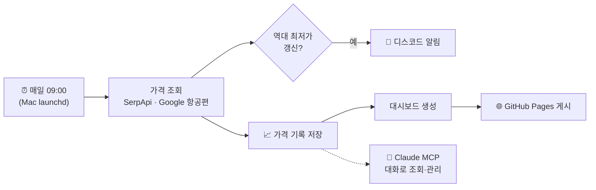

# ✈️ Fare Radar

**인천·김포 출발 왕복 항공권 최저가를 매일 추적하는 개인 대시보드**

🌐 **[moonprod.github.io/fare-radar](https://moonprod.github.io/fare-radar/)**

매일 아침 여러 목적지의 항공권 가격을 조회합니다. 목적지마다 지금까지 본 가장 싼 가격을 기록해 두고, 그보다 싸지면 디스코드로 알림을 보냅니다. 이 저장소에는 그 결과를 보여 주는 대시보드 페이지만 올라갑니다.

---

## 추적 중인 노선

| 목적지 | 공항 | 여행 일정 | 조회 범위 |
|---|---|---|---|
| 🇯🇵 **일본** (도시별 비교) | 도쿄·오사카·후쿠오카·삿포로·오키나와·나고야 등 27개 공항 | 주말을 낀 2~4박 (목·금·토 출발) | 8주 앞까지 |
| 🇬🇧 **런던** | LHR · LGW · STN · LCY | 금·토 출발, 7박 / 10박 | 16주 앞까지 |
| 🇺🇸 **애틀랜타** (경유편만) | ATL | 금·토 출발, 7박 / 10박 | 16주 앞까지 |
| 🇺🇸 **에어프레미아 미국** | 샌프란시스코 · 뉴욕(뉴어크) · LA | 금·토 출발, 7박 / 10박 | 16주 앞까지 |

- 가격은 **왕복 1인, 원화(KRW)** 기준이며 Google 항공편 데이터를 사용합니다.
- 일본 공항은 7개씩 묶어 조회합니다. 주요 도시 묶음은 매일, 지방 공항 묶음은 하루에 하나씩 번갈아 확인합니다.

## 대시보드에서 볼 수 있는 것

- **지금 가장 싼 여행지**: 전체 노선 중 최저가 한 곳
- **목적지 카드**: 목적지별 최저가, 처음 본 가격 대비 하락률, 가격 흐름 그래프
- **출발일별 가격 그래프**: 어느 주말이 싼지 한눈에 보이고, 점에 마우스를 올리면 일정과 항공사가 나옵니다
- **도시 순위**: 일본 도시들을 최저가 순으로 정렬하고, 새로 최저가가 나온 곳에 `NEW LOW` 표시
- 다크 / 라이트 모드, 모바일 화면 지원

## 동작 방식



1. Mac의 예약 실행(launchd)이 매일 오전 9시에 조회 스크립트를 실행합니다. 잠자기 중이었다면 깨어난 직후 실행합니다.
2. 오늘 조회할 날짜 조합을 고릅니다. 아직 확인하지 않은 날짜, 오래전에 확인한 날짜, 가까운 날짜 순입니다.
3. 역대 최저가가 갱신되면 디스코드로 알림을 보냅니다.
4. 모든 조회 결과를 기록해 대시보드를 새로 만들고, 이 저장소에 자동으로 올립니다.

## AI 연동 (MCP)

Claude에 연결된 **Fare Radar MCP 서버**로 가격 기록을 대화하듯 조회하고 관리할 수 있습니다.

| 도구 | 예시 질문 |
|---|---|
| `get_lowest_prices` | "지금 제일 싼 일본 도시 3곳 알려줘" |
| `get_price_history` | "런던 가격 내려가는 추세야?" |
| `find_cheapest_dates` | "11월에 3박 이상 일본 제일 싼 날은?" |
| `search_flights` | "12/4~6 후쿠오카 지금 얼마야?" (실시간) |
| `run_now` | "에어프레미아만 지금 조회해 줘" |
| `add_route` / `remove_route` | "방콕도 추적해 줘" |

## 🔌 내 Claude에 연결하기 (누구나)

공개용 **읽기 전용 MCP 서버**가 있어서, 누구나 자기 Claude에서 이 가격 기록을 물어볼 수 있습니다.

```
https://fare-radar-mcp.vercel.app/mcp
```

1. Claude(웹·데스크톱)에서 **설정 → 커넥터 → 사용자 지정 커넥터 추가**를 엽니다.
2. 이름에 `Fare Radar`, URL에 위 주소를 넣고 추가합니다. 로그인은 필요 없습니다.
3. 채팅에서 "지금 제일 싼 일본 도시 알려줘"처럼 물어보면 됩니다.

공개 서버에서 쓸 수 있는 도구는 `list_routes`, `get_lowest_prices`, `get_price_history`, `find_cheapest_dates`입니다. 저장된 기록만 읽고, 실시간 검색이나 설정 변경은 할 수 없습니다.

## 기술 스택

- **Python**: 조회 스크립트(표준 라이브러리만 사용), MCP 서버(MCP Python SDK)
- **SerpApi**: Google 항공편 검색 데이터
- **Discord Webhook**: 최저가 알림
- **HTML / CSS / 바닐라 JS**: 대시보드 (외부 차트 라이브러리 없이 SVG로 직접 그림)
- **GitHub Pages**: 대시보드 공개

---

> 이 저장소에는 생성된 대시보드(`index.html`)만 공개합니다. 조회 스크립트, API 키, 가격 원본 기록은 로컬에만 있습니다.
> 가격은 조회 시점 기준이며, 실제 예약 가격과 다를 수 있습니다.
